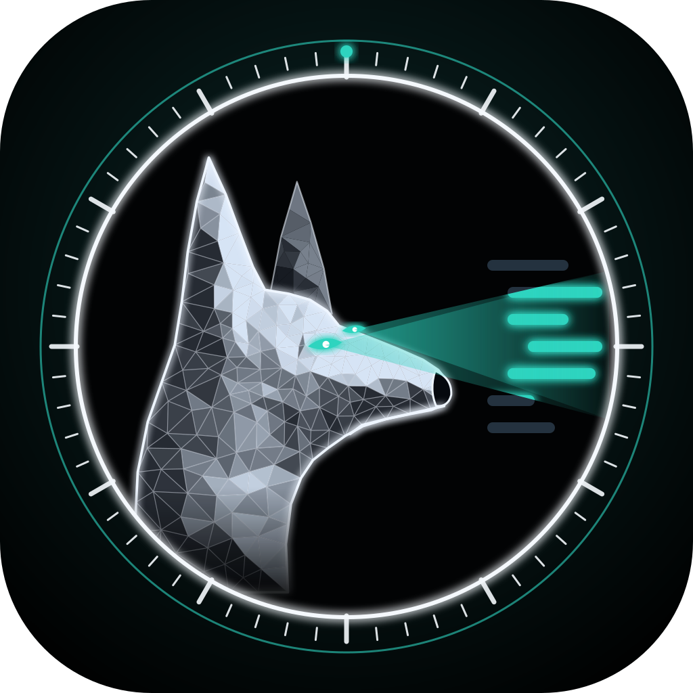

<p align="center"></p>

# Watchdog Lab — website

Source of **https://watchdoglab.github.io/**, the home of Watchdog Lab.

> **Autonomous code needs autonomous security.** Always on guard, fix not fear, safe by design.

The site covers both products: **Watchdog**, a pack of security dogs for Claude Code, and **Watchdog PR Review**, the GitHub Action.

Built the same way as the Pawse site: Next.js 16 (static export), GSAP with ScrollTrigger and SplitText, and Lenis smooth scroll.
All copy, dogs, bundles and FAQ live in `lib/site.ts`, which feeds the page, the JSON-LD and `llms.txt`.
`prefers-reduced-motion` turns the motion off.

## Develop

```sh
npm install
npm run dev        # http://localhost:3000
npm run build      # static export -> out/
```

Deploy with `npm run deploy` (builds and pushes `out/` to the `gh-pages` branch). GitHub Pages needs the repo to be public (or a paid plan).
